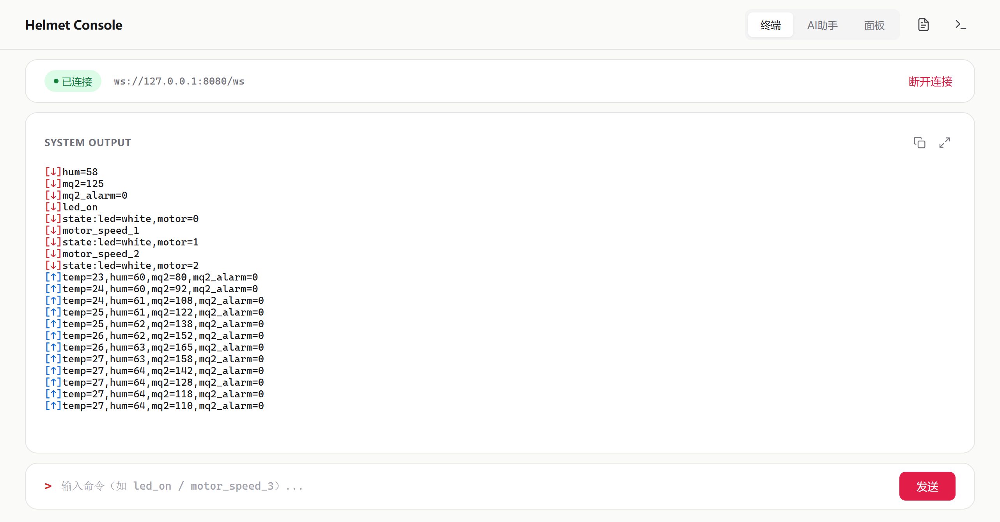
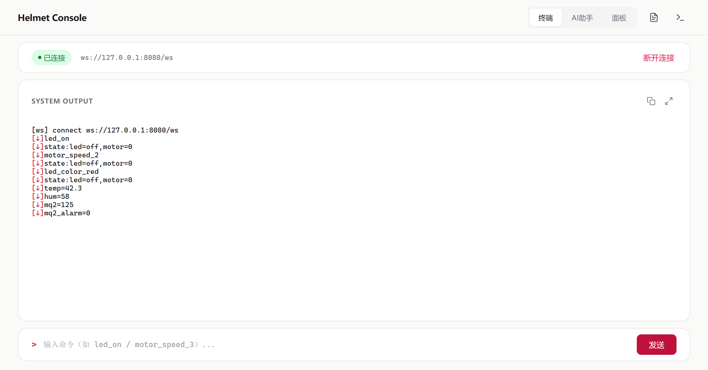
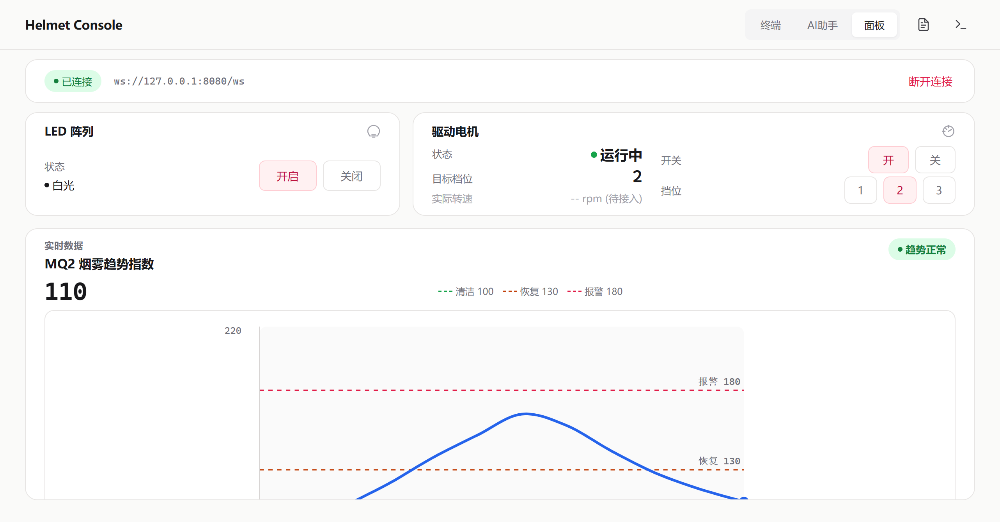
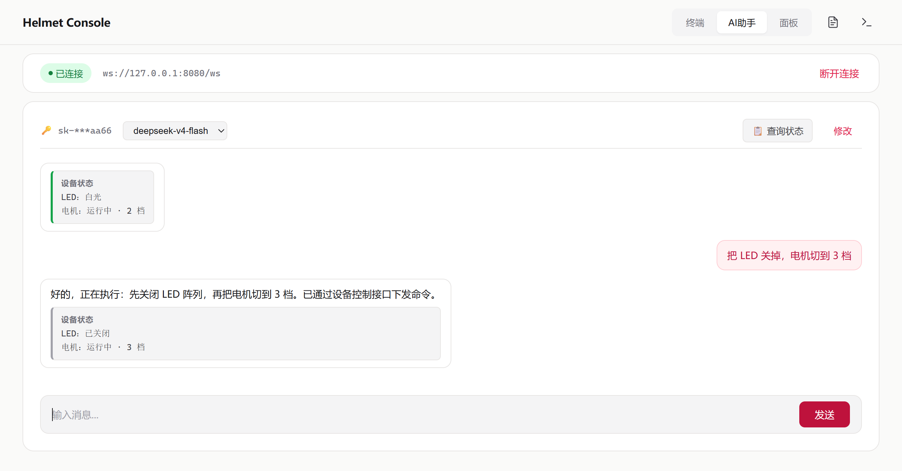
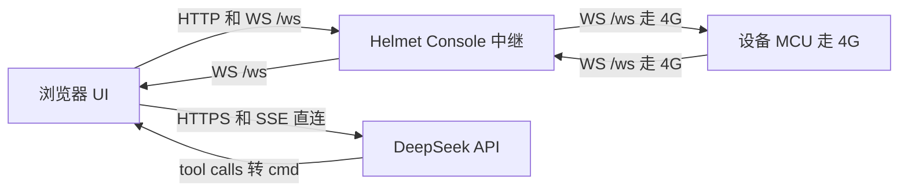

<div align="center">

# Helmet Console

---

### 面向嵌入式设备的主机端 WebSocket 中继

**服务器零解析，前端零构建。**


---

</div>

<p align="center">
  
</p>

Helmet Console 用一个 Node.js 进程做两件事：通过 HTTP 提供浏览器 UI，并在
浏览器与嵌入式设备之间转发 WebSocket 帧。线上的每一帧都是**一行以 `\n`
结尾的 UTF-8 文本** —— 没有 JSON 外壳、没有长度前缀、没有 schema。浏览器把
它敲出来，中继原样转发、不读内容，MCU 用 `strcmp` 分发。

> **线上的字节就是命令本身。** `led_on\n` 从命令栏发出时是 7 个字节，经过
> 中继还是这 7 个字节，到达设备仍然是这 7 个字节。任何一跳都没有东西需要
> 拆包，所以服务端不需要解析器，设备不需要 cJSON，前端也不需要构建管线。

---

## 特性

- **只转发，不解析** —— 每一条文本帧都逐字节广播给其他所有客户端。服务器
  只认一个动词 `ping`，并回以 `pong\n`。不持久化、不维护命令表：新增动词
  无需改服务端。
- **原生浏览器 ESM** —— `web/` 就是一组普通模块，由 `<script type="module">`
  直接加载。没有 Vite、没有 Webpack、没有框架运行时；唯一的第三方库是
  `web/vendor/` 下的 xterm 及其 fit 插件。
- **一页三视图** —— 终端（带方向标记的 xterm + 命令栏）、设备面板（LED、
  电机开关与挡位、MQ2 烟雾趋势图）、AI 助手（浏览器直连 DeepSeek，
  `deepseek-v4-flash` / `deepseek-v4-pro`，把 `tool_calls` 翻译成同一套平铺
  文本命令）。
- **弹性连接** —— 5 态连接状态机，指数退避重连（1 s · 2 s · 4 s · 8 s ·
  16 s，最多 5 次），30 s 心跳，45 s 失活检测，并忽略来自已被替换的旧
  socket 的迟到事件。
- **对 MCU 友好的协议** —— `led_on\n`、`motor_speed_3\n`、`mq2=142\n`。
  每行一次 `strcmp` 就是全部分发逻辑；没有 JSON 解析，WebSocket 之上也没有
  额外的分帧层。
- **本地优先的部署** —— `npm start` 在 `localhost` 上就是完整的一套。可选
  的 Python 启动器会附带 frp 隧道用于公网接入，VPS、token 与域名需自备。

---

## 界面截图

<table>
  <tr>
    <td width="33%" align="center">
      <a href="docs/assets/screenshots/terminal.png"></a>
      <br/><em>终端 —— xterm 中的每一帧，发出 <code>[↓]</code>，收到 <code>[↑]</code></em>
    </td>
    <td width="33%" align="center">
      <a href="docs/assets/screenshots/panel.png"></a>
      <br/><em>面板 —— LED、电机与 MQ2 烟雾趋势实时曲线</em>
    </td>
    <td width="33%" align="center">
      <a href="docs/assets/screenshots/ai-assistant.png"></a>
      <br/><em>AI 助手 —— DeepSeek 工具调用，并固定显示设备状态</em>
    </td>
  </tr>
</table>

---

## 快速开始

```bash
git clone https://github.com/rsecss/helmet-console.git
cd helmet-console
npm ci
npm start
# → http://127.0.0.1:8080
```

打开页面，保留预填的 `ws://127.0.0.1:8080/ws`，点击 **连接**。状态标签变为
**已连接** 后，命令栏即可输入。

手头没有设备？另开一个终端，让 `ws-cli` 扮演设备：

```bash
node server/scripts/ws-cli.js   # 默认连接 ws://127.0.0.1:8080/ws
mq2=142,mq2_alarm=0             # 输入一行并回车 → 出现在浏览器终端与 MQ2 曲线中
```

然后在浏览器里发送 `led_on`，它会打印在这个终端里。这个客户端被设计为交互
式：stdin 结束时它会关闭连接，所以用一条 `echo` 管道喂给它不会把帧送出去。

---

## 线上格式

任何以 `\n` 结尾的 UTF-8 文本行都是一帧。命令栏会按 `\n` 拆分多行输入，
设备永远不必处理帧边界。

| 帧                                    | 方向            | 含义                                     |
| ------------------------------------- | --------------- | ---------------------------------------- |
| `led_on\n` · `led_off\n`              | 浏览器 → 设备   | LED 开（白色）/ 关                       |
| `led_color_<white\|red\|green>\n`     | 浏览器 → 设备   | 设置 LED 颜色并点亮                      |
| `motor_speed_<0..3>\n`                | 浏览器 → 设备   | `0` 停机，`1..3` 选择挡位                |
| `state:led=…,motor=…\n`               | 浏览器 → 对端   | 控制操作后尽力广播的 UI 快照；设备可忽略 |
| `mq2=<n>,mq2_alarm=<0\|1>\n`          | 设备 → 浏览器   | 由面板解析为趋势曲线与报警状态           |
| 其他任意 UTF-8 行（`temp=42.3\n` 等） | 设备 → 浏览器   | 自由格式遥测，原样打印                   |
| `ping\n` / `pong\n`                   | 客户端 ↔ 服务器 | 心跳；服务器唯一会读的帧                 |

中继从不补 `\n`、不改大小写、不加时间戳。二进制帧会让对应连接以 `1003`
关闭。包含心跳时序的完整契约见 [`docs/interface.md`](docs/interface.md)。

---

## 工作原理



只有浏览器理解命令。AI 助手同样跑在浏览器里：API key 留在 `localStorage`，
从不到达中继。在服务器上，字节只是直接穿过。

`web/js/` 里只有 `main.js` 会 import 其他模块；各面板通过注入的回调通信，
每一份共享状态都只有一个写入者。模块图、状态机与延后扩展见
[`docs/architecture.md`](docs/architecture.md)。

设备侧（MCU 固件）在独立仓库：[rsecss/helmet](https://github.com/rsecss/helmet)。

---

## 仓库结构

```text
helmet-console/
├── server/
│   ├── src/          index.js · static.js（HTTP + /healthz）· ws-relay.js · config.js（环境变量）
│   └── scripts/      smoke.js（HTTP + WS 检查）· ws-cli.js（扮演设备的客户端）
├── web/
│   ├── index.html    唯一的页面
│   ├── js/           原生 ESM 模块，由 main.js 拼装
│   ├── css/          样式表
│   └── vendor/       xterm + addon-fit
├── test/             Node test runner 的 WS 客户端回归测试
├── deploy/           start.py 启动器 + frpc.example.toml（真实 frpc.toml 不提交）
├── docs/             文档索引、指南与截图
├── .trellis/         编码规范与 AI 工作流文件
└── logs/             可选的本地输出捕获（不提交）
```

---

## 质量检查

```bash
npm test              # ESLint + 单元测试 + 冒烟
npm run test:unit     # Node test runner —— ws-client 重连/竞态回归
npm run smoke         # 临时服务器：/healthz、广播、ping/pong、二进制关闭
npm run format:check  # Prettier
```

冒烟脚本在随机端口起一个服务器，并断言：`/healthz` 返回 `status: "ok"`、
数值型 `uptime` 和 `clients: 0`；两个客户端能逐字节收到对方的帧；`ping\n`
被回以 `pong\n` 且不被广播；二进制帧会让发送方以 `1003` 关闭。

CI 在 Node 18、20、22 上跑同一套检查。`commit-msg` 钩子
（`simple-git-hooks` + `commitlint`）强制
[Conventional Commits](https://www.conventionalcommits.org/)。

---

## 部署

**本地** —— `npm start`。监听地址、端口、WebSocket 路径与客户端上限由环境
变量控制；变量表与 nginx 升级配置见 [`docs/deployment.md`](docs/deployment.md)。

**公网接入** —— `python deploy/start.py` 同时拉起中继与 `frpc` 并守护两者，
中继意外退出会被重启。VPS、frps token 与域名需自备；把
`deploy/frpc.example.toml` 复制为被忽略的 `deploy/frpc.toml` 并填入你的值。
启动器会先释放 `8080` 端口，这会终止当前占用它的进程 —— 只想跑中继时请用
`npm start`。安装与排障见 [`docs/frp-tunnel.md`](docs/frp-tunnel.md)。

---

## 文档

- [文档索引](docs/README.md) —— 阅读路径与文件提交/忽略矩阵。
- [架构](docs/architecture.md) · [接口](docs/interface.md) ·
  [部署](docs/deployment.md) · [frp 隧道](docs/frp-tunnel.md)
- [贡献指南](docs/contributing.md) —— 环境搭建、分支、提交规范，以及生成 AI
  工具适配器的[固定版本 Trellis 初始化](docs/contributing.md#ai-assisted-development-optional)。
- [`.trellis/spec/`](.trellis/spec/) —— 供 AI 协作者使用的后端 / 前端编码规则。
- [更新日志](CHANGELOG.md) —— 发布历史。

---

## 许可证

[MIT](LICENSE)
